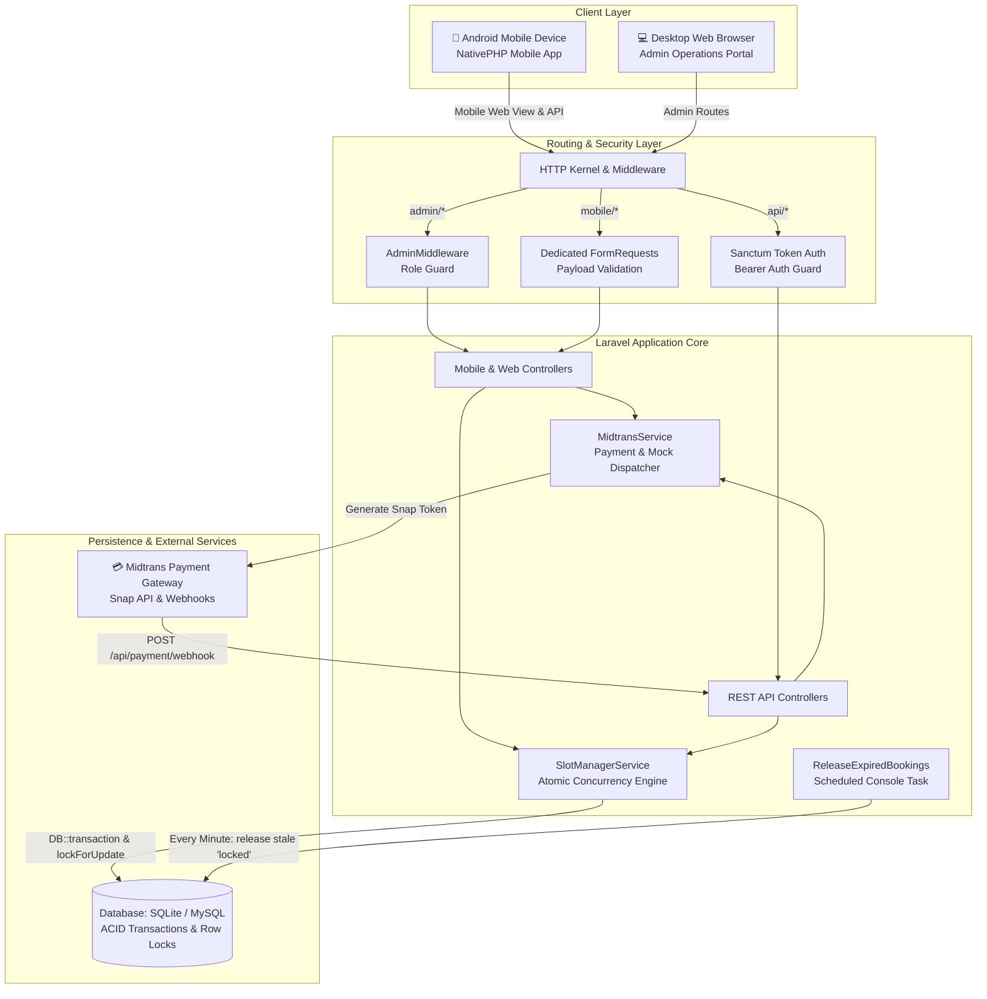

# 🏟️ Champion Sports Arena & Court Booking App

> A high-performance, real-time sports court reservation platform featuring a **NativePHP Mobile** Android application for players and a comprehensive **Web Admin Portal** for arena operators, powered by **Laravel 13**, **Tailwind CSS v4**, and **Midtrans Snap Payment Gateway**.

[](https://laravel.com)
[](https://nativephp.com)
[](https://php.net)
[](https://tailwindcss.com)
[](https://pestphp.com)
[](LICENSE)

---

## 📑 Table of Contents

- [About](#-about)
- [Features](#-features)
    - [Mobile Customer App](#-mobile-customer-app-nativephp)
    - [Web Admin Dashboard](#-web-admin-dashboard)
    - [Concurrency & Locking Engine](#-concurrency--locking-engine)
- [Tech Stack](#-tech-stack)
- [Architecture](#-architecture)
- [Project Structure](#-project-structure)
- [Getting Started](#-getting-started)
    - [Prerequisites](#prerequisites)
    - [Installation](#installation)
    - [Running the Application](#running-the-application)
- [Configuration](#-configuration)
    - [Environment Variables](#environment-variables)
    - [Default Seeded Credentials](#default-seeded-credentials)
- [Security](#-security)
- [How to Contribute?](#-how-to-contribute)
- [What's Next?](#-whats-next)
- [License](#-license)
- [Acknowledgements](#-acknowledgements)
- [Author](#-author)

---

## 📖 About

Sports facilities often suffer from fragmented booking processes: double-booked courts over messaging apps, delayed bank transfer verifications, manual schedule mix-ups, and frustrated customers waiting for confirmations.

The **Champion Sports Arena & Court Booking System** provides an end-to-end, automated solution designed specifically for modern badminton, futsal, basketball, and padel facilities:

1. **Native Mobile Experience**: Built with [NativePHP Mobile](https://nativephp.com), enabling PHP and Laravel developers to package true native Android apps without writing Java/Kotlin or juggling separate frontend repositories.
2. **Atomic Concurrency Protection**: High-demand court booking creates peak contention during evenings and weekends. The platform incorporates database-level pessimistic locking (`lockForUpdate`) that temporarily reserves slots for 15 minutes during checkout, preventing double bookings.
3. **Automated Payment Lifecycle**: Deep integration with Midtrans Snap supports both simulated mock testing and production Indonesian payment rails (QRIS, GoPay, BCA/Mandiri/BRI Virtual Accounts, Credit Cards), automatically updating slot statuses via secure webhook verification.
4. **Operations Control Center**: Arena managers enjoy a dedicated web dashboard to oversee daily schedules, monitor revenue metrics, manage court maintenance, and process walk-in manual check-ins.

---

## ✨ Features

### 📱 Mobile Customer App (NativePHP)

- **Interactive Arena & Court Catalog**: Browse courts filtered by sport category (Badminton, Futsal), court surface (Interlocking Vinyl, Taraflex, Synthetic Turf), and amenities.
- **14-Day Calendar Carousel**: Real-time date selector showing dynamic slot counts for each day.
- **Dynamic Slot Availability Matrix**: Hourly schedule grid displaying real-time slot states:
    - 🟢 **Available**: Ready to select with pricing breakdown.
    - 🟡 **Locked / In Checkout**: Held by another player in their 15-minute checkout window.
    - 🔴 **Booked / Confirmed**: Fully occupied.
- **15-Minute Live Checkout Timer**: Visual countdown ensuring slot exclusivity while completing payment.
- **Multi-Hour Continuous Booking**: Select single or multiple consecutive time slots in one booking.
- **Midtrans Snap Payment Integration**: Seamless modal checkout supporting QRIS, E-wallets, and Bank Transfer with mock simulation mode for testing.
- **Digital E-Ticket with QR Code**: Confirmed reservations generate scannable E-tickets with booking code, court rules, and venue navigation details.
- **Tabbed Booking History**: Filter tickets across **Active (Upcoming)**, **Completed**, and **Cancelled** states.
- **Customer Profile & Auth**: Lightweight login/registration system with profile and quick logout.

### 💻 Web Admin Dashboard

- **Executive Metrics & KPIs**: Instant visibility into total bookings, completed reservations, active locks, and total revenue.
- **Court Schedule Grid**: Live date-picker showing morning, afternoon, and evening booking statuses per court.
- **Court Facility Management**:
    - Add and edit courts (name, sport type, hourly rates, operational hours).
    - One-click active/maintenance toggle to pull courts off the schedule for cleaning or repairs.
- **Booking Ledger & Filter**: Search and filter bookings by date, status, payment method, or booking reference code.
- **Walk-in Manual Check-in**: Arena staff can mark players as attended or cancel expired bookings on the spot.

### ⚡ Concurrency & Locking Engine

- **Atomic Database Locks**: Uses `DB::transaction()` with `lockForUpdate()` on court slots to ensure zero race conditions when multiple users attempt to reserve the same slot simultaneously.
- **Automated Expired Lock Releaser**: Background scheduled command (`bookings:release-expired`) running every minute to free up abandoned locks and restore availability.
- **Strict FormRequest Architecture**: 100% of incoming payloads pass through dedicated Laravel `FormRequest` classes, keeping controllers clean and validating input rules before business logic runs.

---

## 🛠️ Tech Stack

| Domain                 | Technology / Library                                                                 | Purpose                                                                        |
| :--------------------- | :----------------------------------------------------------------------------------- | :----------------------------------------------------------------------------- |
| **Backend Framework**  | [Laravel 13.x](https://laravel.com)                                                  | Core application framework, Eloquent ORM, scheduled jobs                       |
| **Language**           | [PHP 8.3 / 8.5](https://php.net)                                                     | Strongly typed backend execution                                               |
| **Mobile Shell**       | [NativePHP Mobile 4.7](https://nativephp.com)                                        | Android native application packaging & bridge                                  |
| **API Authentication** | [Laravel Sanctum 4.x](https://laravel.com/docs/sanctum)                              | Token-based secure REST API authentication                                     |
| **Frontend UI**        | [Blade](https://laravel.com/docs/blade) + [Tailwind CSS v4](https://tailwindcss.com) | Ultra-responsive, mobile-first design with modern dark & light utility classes |
| **Icons**              | [Lucide Icons](https://lucide.dev)                                                   | Modern, crisp UI icons                                                         |
| **Asset Bundler**      | [Vite 8.x](https://vitejs.dev)                                                       | Lightning-fast asset compilation and live HMR                                  |
| **Database**           | [SQLite](https://www.sqlite.org) / [MySQL](https://www.mysql.com)                    | ACID-compliant storage with row-level transactional locking                    |
| **Payment Gateway**    | [Midtrans Snap](https://midtrans.com)                                                | QRIS, Virtual Account, & E-Wallet processing with Mock mode                    |
| **Code Formatter**     | [Laravel Pint](https://laravel.com/docs/pint)                                        | PSR-12 and Laravel opinionated coding standards                                |
| **Test Suite**         | [Pest PHP 5.x](https://pestphp.com)                                                  | Expressive testing framework with 40+ unit and feature tests                   |

---

## 🏗️ Architecture



### Slot Concurrency State Machine

```
[ Available ] ──(User initiates checkout)──> [ Locked (15-min TTL) ]
     ▲                                                │
     │                                     ┌──────────┴──────────┐
     │ (15m timeout or user cancel)       │                     │ (Payment Confirmed)
     └────────────────────────────────────┘                     ▼
                                                         [ Confirmed ]
```

---

## 📂 Project Structure

```text
sports-arena/
├── app/
│   ├── Console/
│   │   └── Commands/
│   │       └── ReleaseExpiredBookingsCommand.php # Scheduled lock release job
│   ├── Http/
│   │   ├── Controllers/
│   │   │   ├── Admin/
│   │   │   │   ├── AdminBookingController.php    # Admin booking list & check-in
│   │   │   │   ├── AdminCourtController.php      # Admin court CRUD & maintenance toggle
│   │   │   │   └── AdminDashboardController.php  # Admin KPI & live schedule
│   │   │   ├── Api/
│   │   │   │   ├── AuthController.php            # Sanctum login, register, logout
│   │   │   │   ├── BookingApiController.php      # Court slot query & reservation API
│   │   │   │   ├── MidtransWebhookController.php # Webhook signature verification & updates
│   │   │   │   └── VenueApiController.php        # Venue & court catalog API
│   │   │   └── Mobile/
│   │   │       ├── MobileAuthController.php      # Mobile web session auth
│   │   │       └── MobileController.php          # Mobile browse, booking, checkout & tickets
│   │   ├── Middleware/
│   │   │   └── AdminMiddleware.php               # Enforces role === 'admin'
│   │   └── Requests/                             # Dedicated validation requests
│   │       ├── CheckAvailabilityRequest.php
│   │       ├── LoginRequest.php
│   │       ├── RegisterRequest.php
│   │       ├── ReserveSlotWebRequest.php
│   │       ├── StoreBookingRequest.php
│   │       ├── StoreCourtRequest.php
│   │       └── UpdateCourtRequest.php
│   ├── Models/
│   │   ├── Booking.php                           # Booking header with payment status
│   │   ├── BookingSlot.php                       # Individual court hourly slot
│   │   ├── Court.php                             # Sport court attributes & slots
│   │   ├── User.php                              # User with customer/admin roles
│   │   └── Venue.php                             # Arena profile & courts relationship
│   └── Services/
│       ├── MidtransService.php                   # Midtrans Snap & Mock simulation
│       └── SlotManagerService.php                # Concurrency locks & availability logic
├── database/
│   ├── migrations/                               # Venues, courts, bookings, booking_slots
│   └── seeders/
│       ├── DatabaseSeeder.php
│       └── VenueSeeder.php                       # Seeds Sports Arena, 5 courts, users
├── resources/
│   ├── css/
│   │   └── app.css                               # Tailwind CSS v4 styling
│   └── views/
│       ├── admin/                                # Admin blade views (dashboard, courts, bookings)
│       └── mobile/                               # Mobile viewport views (home, checkout, tickets)
├── routes/
│   ├── api.php                                   # REST API endpoints with Sanctum guards
│   ├── console.php                               # Scheduler registering bookings:release-expired
│   └── web.php                                   # Mobile web views & Admin portal routes
└── tests/
    └── Feature/                                  # 41 Pest feature & integration tests
```

---

## 🚀 Getting Started

### Prerequisites

Ensure your development environment meets the following requirements:

- **PHP**: `^8.5` with `pdo_mysql`, `mbstring`, `openssl`, and `curl` extensions.
- **Composer**: `^2.x`
- **Node.js**: `^18.x` or `^20.x` & `npm`
- **Git**
- _(Optional for Android APK packaging)_: **Android Studio**, **Java JDK 17+**, and Android SDK configured for [NativePHP Mobile](https://nativephp.com/docs/mobile/getting-started).

### Installation

1. **Clone the repository**:

    ```bash
    git clone https://github.com/mby444/sports-arena.git
    cd sports-arena
    ```

2. **Install PHP dependencies**:

    ```bash
    composer install
    ```

3. **Install JavaScript dependencies & build assets**:

    ```bash
    npm install
    npm run build
    ```

4. **Environment Setup**:

    ```bash
    cp .env.example .env
    php artisan key:generate
    ```

5. **Initialize Database & Seed Test Data**:

    ```bash
    # Run migrations and seed sample arena, courts, slots, and users
    php artisan migrate:fresh --seed
    ```

### Running the Application

#### Option A: Web / Mobile Browser Preview (Fastest)

Run the built-in development server:

```bash
php artisan serve
```

Open your browser:

- **Mobile Experience**: [http://127.0.0.1:8000](http://127.0.0.1:8000) _(Switch your browser DevTools to Mobile viewport, e.g. iPhone 14 Pro or Pixel 7)_
- **Web Admin Portal**: [http://127.0.0.1:8000/admin](http://127.0.0.1:8000/admin)

#### Option B: Full Dev Stack with Vite Live Reload

```bash
npm run dev
# In another terminal:
php artisan serve
```

#### Option C: NativePHP Mobile Live Preview (Android Emulator / Device)

If you have the NativePHP Mobile tooling and Android environment configured:

```bash
# Launch hot-reloading native session
php artisan native:jump
```

---

## ⚙️ Configuration

### Environment Variables

Configure these settings in your `.env` file:

| Variable                 | Default Value           | Description                                                                               |
| :----------------------- | :---------------------- | :---------------------------------------------------------------------------------------- |
| `APP_NAME`               | `"Sports Arena"`        | Name of the sports venue application                                                      |
| `APP_ENV`                | `local`                 | Environment (`local`, `production`)                                                       |
| `APP_DEBUG`              | `true`                  | Show detailed debug pages in development                                                  |
| `APP_URL`                | `http://127.0.0.1:8000` | Base URL of the application                                                               |
| `DB_CONNECTION`          | `mysql`                 | Database driver (`sqlite`, `mysql`, `pgsql`)                                              |
| `MIDTRANS_SERVER_KEY`    | `SB-Mid-server-xxx`     | Midtrans Snap Server Key                                                                  |
| `MIDTRANS_CLIENT_KEY`    | `SB-Mid-client-xxx`     | Midtrans Snap Client Key                                                                  |
| `MIDTRANS_IS_PRODUCTION` | `false`                 | `true` for live transactions, `false` for Sandbox                                         |
| `MIDTRANS_MOCK`          | `true`                  | When `true`, simulates instant payments without requiring external Midtrans network calls |

> [!TIP]
> Keep `MIDTRANS_MOCK=true` during local development and testing to instantly simulate successful payments, QRIS generation, and webhook triggers with zero setup!

### Default Seeded Credentials

The database seeder provisions two ready-to-use accounts:

| Role             | Email             | Password   | Permissions                                                                |
| :--------------- | :---------------- | :--------- | :------------------------------------------------------------------------- |
| **System Admin** | `admin@arena.com` | `password` | Full access to `/admin` dashboard, court configuration, and booking ledger |
| **Customer**     | `budi@arena.com`  | `password` | Book courts, view tickets, manage customer profile                         |

---

## 🔒 Security

This application implements multi-layered security controls to safeguard financial transactions and venue operations:

1. **Pessimistic Concurrency Locking**:
    - Every court reservation uses `DB::transaction()` combined with `lockForUpdate()`.
    - Prevents race conditions and double bookings even under heavy concurrent load.
2. **Strict Request Validation**:
    - Zero raw controller inputs. Every API and web route passes through a dedicated `FormRequest` with validated types, date rules, and time constraints.
3. **Midtrans Webhook Verification**:
    - Inbound webhook notifications calculate a SHA-512 signature hash:
        ```php
        $signatureKey = hash('sha512', $orderId . $statusCode . $grossAmount . $serverKey);
        ```
    - Requests with mismatched signatures are immediately rejected with `403 Forbidden`.
4. **Role-Based Access Control (RBAC)**:
    - Protected admin routes use the `AdminMiddleware`, verifying that `$user->role === 'admin'`. Unauthorized requests receive `403 Access Denied`.
5. **Sanctum Token Authentication**:
    - API endpoints use hashed bearer tokens with scoped revocation upon logout.

---

## 🤝 How to Contribute?

Contributions are welcome! Follow these steps to contribute:

1. **Fork the Repository** on GitHub.
2. **Create a Feature Branch**:
    ```bash
    git checkout -b feature/dynamic-pricing
    ```
3. **Write Clean, Tested Code**:
    - Adhere to Laravel conventions and constructor property promotion.
    - Run tests to verify existing features remain green:
        ```bash
        vendor/bin/pest
        ```
4. **Format Your Code with Laravel Pint**:
    ```bash
    vendor/bin/pint --format agent
    ```
5. **Commit Your Changes**:
    ```bash
    git commit -m "feat: add dynamic peak-hour court pricing rules"
    ```
6. **Push to Your Fork & Open a Pull Request**:
    ```bash
    git push origin feature/dynamic-pricing
    ```
    Provide a clear summary of your changes and any relevant issue references in your PR description.

---

## 🔮 What's Next?

Our development roadmap includes the following planned enhancements:

- [ ] **WhatsApp OTP Authentication**: Direct login with phone number and OTP verification using Twilio / WhatsApp Cloud API.
- [ ] **Multi-Venue Multi-Tenant Support**: Allow multiple sports centers to join and manage separate arenas on a single platform.
- [ ] **Android System Calendar & Push Notifications**: Native calendar event sync and push reminders 2 hours before court time via NativePHP notifications.
- [ ] **Equipment Rental Add-ons**: Allow players to add shuttlecocks, rackets, and referee services during checkout.
- [ ] **Dynamic Peak-Hour Pricing Engine**: Automatically adjust slot pricing for prime weekend and evening hours.

---

## 📄 License

This project is open-sourced software licensed under the [MIT License](LICENSE).

---

## 🙏 Acknowledgements

We gratefully acknowledge the open-source projects and platforms that make this application possible:

- [Laravel Framework](https://laravel.com) — For providing the most elegant, developer-friendly PHP ecosystem.
- [NativePHP Team](https://nativephp.com) — For enabling native mobile application capabilities directly from PHP.
- [Tailwind CSS](https://tailwindcss.com) — For the flexible utility-first styling engine.
- [Midtrans](https://midtrans.com) — For reliable payment gateway infrastructure across Southeast Asia.
- [Pest PHP](https://pestphp.com) — For making testing an intuitive and delightful experience.
- [Lucide Icons](https://lucide.dev) — For the beautiful and accessible icon library.

---

## 👤 Author

**Sports Arena Engineering Team**

- **GitHub**: [@mby444](https://github.com/mby444)
